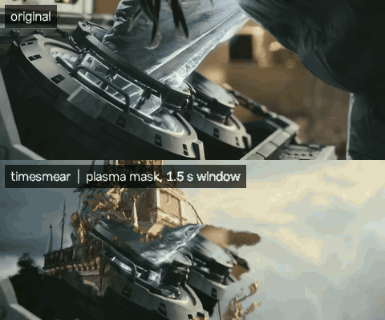
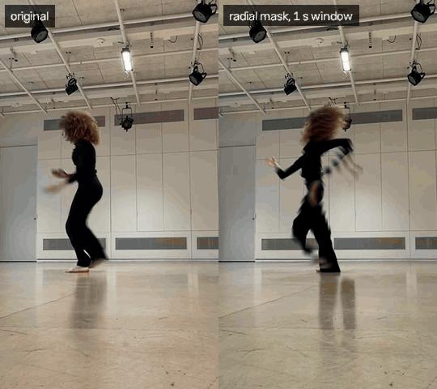
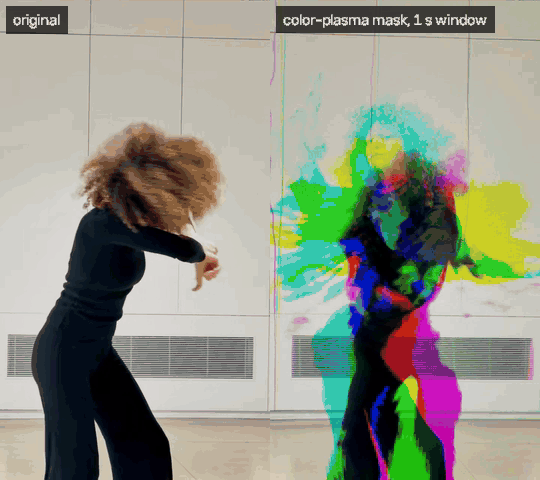

# timesmear

A **time displacement** video effect. Every pixel of the output shows that same pixel from some
moment in the past, and a grayscale mask decides how far back each one looks.

<p align="center">
  
  <br>
  <sub>Top: original. Bottom: <code>mask-plasma.png</code>, 1.5 s window.
  Footage from <a href="https://mango.blender.org/"><i>Tears of Steel</i></a> © Blender Foundation, CC-BY.</sub>
</p>

```
mask pixel   black ──────────── gray ──────────── white
shows        now          window/2 seconds ago    window seconds ago
```

Paint the mask with a left-to-right gradient and moving objects stretch and lean, the classic
slit-scan look. Use a cloudy plasma mask and scene cuts dissolve through the frame in organic
patches, with part of the picture still in the old shot while the rest has moved on.

A radial mask keeps the center live while the edges trail behind. At a cut, the new shot
grows outward from the middle as an expanding circle:

<p align="center">
  
  <br>
  <sub>Left: original. Right: radial mask (the default), 1 s window.
  Dance footage by Dana Margalit (<a href="https://www.tiktok.com/@d.margalit">@d.margalit</a> on TikTok).</sub>
</p>

## Contents

- [Requirements](#requirements)
- [Quick start](#quick-start)
- [How it works](#how-it-works)
- [Color masks](#color-masks): per-channel delays
- [timedisplace.py](#timedisplacepy): apply the effect
- [makemask.py](#makemaskpy): generate masks
- [bootstrap.sh](#bootstrapsh): fetch reference clips
- [Recipes](#recipes)
- [Performance and memory](#performance-and-memory)
- [Troubleshooting](#troubleshooting)
- [Development](#development)
- [License and credits](#license-and-credits)

## Requirements

- [uv](https://docs.astral.sh/uv/), which runs the scripts. On first run it fetches a suitable
  Python plus OpenCV, NumPy and Numba automatically, so there's no virtualenv to manage.
- [ffmpeg](https://ffmpeg.org/), which carries over the audio and encodes the final video.
- [yt-dlp](https://github.com/yt-dlp/yt-dlp) is optional. `bootstrap.sh` falls back to
  `uvx yt-dlp` if it isn't installed.

On macOS:

```bash
brew install uv ffmpeg
```

## Quick start

```bash
git clone https://github.com/jtdevos/timesmear.git
cd timesmear
./bootstrap.sh
uv run timedisplace.py resources/tears-of-steel.webm 1.5 -t plasma
```

`bootstrap.sh` downloads three short reference clips and generates a set of mask images. The
last command generates a plasma mask at the video's size and writes something like
`resources/tears-of-steel_plasma-seed1234_1.5s.mp4`. The filename records the settings, so you
can tell renders apart and reproduce any of them.

Every command prints full help with `-h`, or when you run it with no arguments.

## How it works

For output frame `t` and pixel `(x, y)`:

```
delay  = mask[y, x] * window * fps        # in frames, usually fractional
output = input[t - delay][y, x]
```

- **Frame buffer:** the tool keeps the last `window` seconds of frames in memory (a ring
  buffer), so it can stream through videos of any length.
- **Blending:** delays usually fall between two frames, so by default each pixel blends the two
  nearest frames for smooth motion. `--fast` snaps to the nearest frame instead, for slightly
  steppier motion. Since encoding the output now takes most of the time, it saves little.
- **The first few seconds:** until `window` seconds of history exist, pixels that would look
  back before the start show the first frame. The opening of the output therefore starts frozen
  and comes to life as the buffer fills.
- **Past only:** pixels never look into the future, which keeps memory bounded and would also
  work for live input.

## Color masks

A color mask gives each color channel its own delay. The red channel of the mask sets how far
back the video's red channel looks, green sets green's delay, and blue sets blue's:

```
output.red   = input[t - mask.red   * window * fps].red
output.green = input[t - mask.green * window * fps].green
output.blue  = input[t - mask.blue  * window * fps].blue
```

Wherever something moves, its red, green and blue copies separate into colored ghosts (magenta,
cyan and yellow fringes and trails), and they come back together once the motion stops. Still
areas look untouched.

<p align="center">
  
  <br>
  <sub>Left: original. Right: <code>-t color-plasma --seed 7</code>, 1 s window.
  Dance footage by Dana Margalit (<a href="https://www.tiktok.com/@d.margalit">@d.margalit</a> on TikTok).</sub>
</p>

- `-t color-plasma` generates a separate plasma cloud for each channel, so the color split
  varies across the frame.
- `-t color-radial` gives each channel its own radial gradient: one small, one medium and one
  large, each with a slightly shifted center and a 50% chance of being inverted (lagging in the
  middle instead of at the edges). Cuts open as overlapping colored circles, and moving things
  pick up colored halos. Try a few `--seed` values; each gives a different combination.
- You can paint one too. Pure black is "now" for every channel; pure red delays only the red
  channel by the full window; white delays all three equally, the same as a grayscale mask.
- A mask whose channels are all equal (any gray image, even if saved as RGB) is treated as
  grayscale and processed the usual way.

## timedisplace.py

```bash
uv run timedisplace.py INPUT WINDOW [-m MASK | -t TYPE] [options]
```

| Argument | Meaning |
|---|---|
| `INPUT` | Any video ffmpeg can read: mp4, webm, mkv, mov, … |
| `WINDOW` | Delay in seconds for a pure white mask pixel |
| `-m, --mask` | Mask image, grayscale or [color](#color-masks), ideally a 16-bit PNG. If it's a different size from the video, it's stretched to fit. |
| `-t, --mask-type` | Generate a mask at the video's size instead: `horizontal`, `vertical`, `radial`, `noise`, `plasma`, `color-plasma` or `color-radial` (see [makemask.py](#makemaskpy)). If neither `-m` nor `-t` is given, you get `radial`. |
| `--seed` | Random seed for the `noise`, `plasma`, `color-plasma` and `color-radial` types. Without it, a random seed is chosen and printed so you can reproduce a result you like. |
| `--roughness` | Detail level for the `plasma` and `color-plasma` types, from 0 to 1 (default 0.5) |
| `-o, --output` | Output path. `.webm` gives VP9/Opus; anything else gives H.264/AAC (hardware-encoded on Macs). Without it, the output goes next to the input, named after the settings (see below). |
| `--fast` | Use the nearest frame instead of blending two |
| `--preview` | Show the output in a window while rendering (press `q` to stop) |
| `--no-output` | Use with `--preview` to watch without writing a file |

The original audio is copied into the output, unchanged.

Without `-o`, the output is named `<input>_<mask>_<window>s[_fast].mp4` and saved next to the
input. For a generated mask, the name includes the seed (and `--roughness`, if it isn't the
default), so any render can be reproduced from its filename:

| Command | Output |
|---|---|
| `timedisplace.py dance.mp4 1` | `dance_radial_1s.mp4` |
| `timedisplace.py dance.mp4 1.5 -t color-plasma --seed 7` | `dance_color-plasma-seed7_1.5s.mp4` |
| `timedisplace.py dance.mp4 1.5 -t plasma --roughness 0.7` | `dance_plasma-seed<random>-rough0.7_1.5s.mp4` |
| `timedisplace.py dance.mp4 3 -m mask-ghost.png --fast` | `dance_mask-ghost_3s_fast.mp4` |

Running the same settings again overwrites the earlier file, since it would contain the same
video.

## makemask.py

```bash
uv run makemask.py PATTERN WIDTH HEIGHT [-o mask.png] [--invert] [--seed N] [--roughness R]
```

| Pattern | Looks like | Effect on video |
|---|---|---|
| `horizontal` | left→right gradient | Classic slit-scan: motion leans and stretches sideways |
| `vertical` | top→bottom gradient | The same, but vertical. Good for falling or rising motion. |
| `radial` | center→corners | Center is live and edges trail behind, like a tunnel |
| `noise` | soft random blobs | Patchy, uneven lag |
| `plasma` | cloudy fractal | Organic, smoky dissolves, especially at scene cuts |
| `color-plasma` | three plasma clouds, one per channel | Red, green and blue drift apart into colored ghosts ([color masks](#color-masks)) |
| `color-radial` | three differently sized radials, randomly inverted | Colored circles at cuts and colored halos on motion |

| Option | Meaning |
|---|---|
| `--invert` | Swap black and white, so a radial mask lags at the center instead |
| `--seed N` | Make `noise`, `plasma`, `color-plasma` and `color-radial` reproducible |
| `--roughness R` | For `plasma` and `color-plasma`, from 0 to 1 (default 0.5). Low gives big soft blobs; high gives fine, grainy clouds. |

Use `makemask.py` when you want to keep a mask, edit it by hand, or reuse it across videos.
For one-off renders, `timedisplace.py -t` generates the same patterns on the fly.

Masks are saved as 16-bit PNGs, because 8 bits gives only 256 delay steps, which can show up as
banding with long windows. You can also paint a mask in any image editor: black means now and
white means oldest.

## bootstrap.sh

```bash
./bootstrap.sh
```

This downloads every clip in `resources/videos.txt` and generates `mask-horizontal`,
`mask-vertical`, `mask-radial` and `mask-plasma` (seed 1) into `resources/`. Anything already
there is skipped. To fetch or regenerate something, delete it and re-run.

Each line of `videos.txt` has a name, a URL and an optional time range, so only that section is
downloaded:

```
tears-of-steel   https://www.youtube.com/watch?v=R6MlUcmOul8   7:00-8:00
```

### Using your own videos

Put them in `resources/videos.local.txt`, which uses the same format and is gitignored.
`bootstrap.sh` will download them alongside the reference clips. You can also just drop files into
`resources/`.

Nothing in `resources/` is committed except `videos.txt`. Video files (`*.webm`, `*.mp4`,
`*.mkv`, `*.mov`, …) and the `clips/` and `out/` folders are ignored everywhere in the repo, so
renders and personal footage can't be committed by accident.

## Recipes

```bash
# Center stays live, edges trail behind (the default radial mask)
uv run timedisplace.py resources/spring.webm 1

# Slit-scan smear: the left edge is live, the right edge lags 2 seconds
uv run timedisplace.py resources/big-buck-bunny.webm 2 -t horizontal

# Plasma dissolves through scene cuts, saved as WebM
uv run timedisplace.py resources/tears-of-steel.webm 1.5 -t plasma -o out/tos.webm

# Red, green and blue drift apart into colored ghosts
uv run timedisplace.py resources/big-buck-bunny.webm 1 -t color-plasma --seed 7

# Colored circles and halos; each seed gives a different mix of sizes and inversions
uv run timedisplace.py resources/spring.webm 1 -t color-radial --seed 2

# Inverted fine plasma with a long window, for a dreamy, ghostly look
uv run makemask.py plasma 1920 1080 --roughness 0.7 --invert --seed 3 -o resources/mask-ghost.png
uv run timedisplace.py resources/spring.webm 3 -m resources/mask-ghost.png

# Try out settings live before committing to a full render
uv run timedisplace.py resources/spring.webm 1 -t plasma --fast --preview --no-output

# Cut a short test clip from a long video (instant, with no re-encode)
mkdir -p clips
ffmpeg -ss 120 -t 30 -i long-video.webm -c copy clips/test.webm
```

Tips:

- **Motion and cuts are what make it.** A still shot looks nearly untouched. Footage with lots
  of movement or frequent cuts shows the effect best.
- **Window size:** 0.5–1 s gives subtle wobble, 1–3 s gives obvious smears and dissolves, and
  5 s or more makes long trails, at a cost in memory.
- **Iterate on short clips.** Use `--fast --preview --no-output` to explore, then do a blended
  render of the version you like.

## Performance and memory

The effect runs as compiled, multithreaded code (via [Numba](https://numba.pydata.org/)), and
frames are piped straight into ffmpeg, which encodes them once. On a Mac, MP4 output uses Apple's
hardware H.264 encoder (VideoToolbox), which leaves the CPU free for decoding and the effect.
On other systems it falls back to x264. Measured on an M1 Max:

| Stage | Speed at 1080p |
|---|---|
| Effect, grayscale mask | ~520 fps blended, ~1000 fps with `--fast` |
| Effect, color mask | ~290 fps blended, ~530 fps with `--fast` |
| Whole pipeline (decode, effect, H.264 encode) | ~170 fps for 1920×800, color-plasma mask |

At that rate, an 11-minute 1080p video takes about 2 minutes. Without the hardware encoder (x264,
on non-Mac systems), expect about a third of that speed. WebM (VP9) output is always
software-encoded and much slower than MP4.

The hardware encoder's quality setting (`-q:v 75`) was chosen to match x264 CRF 18 on VMAF, a
perceptual quality score. In exchange for being nearly 3x faster, files come out about 13%
larger.

The first time you run `timedisplace.py`, Numba compiles the effect, which adds a few seconds.
The compiled code is cached in `__pycache__`, so later runs start straight away.

Memory is about `window × fps × width × height × 3` bytes, and the tool prints the estimate when
it starts:

| Video | 1 s window | 3 s window | 10 s window |
|---|---|---|---|
| 1080p, 24 fps | ~150 MB | ~450 MB | ~1.5 GB |
| 1080p, 60 fps | ~375 MB | ~1.1 GB | ~3.7 GB |

## Troubleshooting

- **"wrote … (no audio; ffmpeg unavailable or failed)":** ffmpeg isn't on your `PATH`, or it
  couldn't encode for that container. The silent fallback file is always saved as `.mp4`.
- **"could not open video":** OpenCV's bundled decoder can't read that file. Re-encode it first:
  `ffmpeg -i in.xyz -c:v libx264 in.mp4`.
- **A YouTube download fails with 403:** this is usually transient, so re-run `bootstrap.sh`. If
  it keeps happening, update yt-dlp.
- **Banding in smooth gradients:** use a 16-bit PNG mask. `makemask.py` already does this.

## Development

`tests/test_timedisplace.py` checks that the optimized effect matches a plain NumPy version of the
algorithm bit for bit, for grayscale and color masks, blended and `--fast`:

```bash
uv run tests/test_timedisplace.py
```

Run it after changing anything in `TimeDisplacer` or its kernels.

## License and credits

The code is released under the [MIT License](LICENSE).

The reference clips aren't included in this repo. `bootstrap.sh` downloads excerpts of these
[Blender open movies](https://studio.blender.org/films/), all licensed
[CC-BY](https://creativecommons.org/licenses/by/4.0/):

- *Big Buck Bunny* (2008), © Blender Foundation, [peach.blender.org](https://peach.blender.org/)
- *Tears of Steel* (2012), © Blender Foundation, [mango.blender.org](https://mango.blender.org/)
- *Spring* (2019), © Blender Animation Studio, [studio.blender.org](https://studio.blender.org/films/spring/)

If you publish renders made from them, credit the original film.

The demo GIF, `docs/demo.gif`, is made from *Tears of Steel* footage and is shared under the
same CC-BY license.

The dance demos, `docs/demo-dance.gif` and `docs/demo-color-plasma.gif`, use footage by Dana Margalit
([@d.margalit](https://www.tiktok.com/@d.margalit) on TikTok). The original video isn't
included in this repo.
